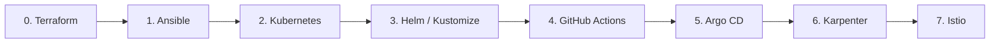

# DevOps & Platform Engineering Workshops
Repositorio central y catálogo de rutas de aprendizaje prácticas. Cada laboratorio se encuentra desacoplado en un repositorio individual con su propio código ejecutable, contexto, validaciones y capturas paso a paso.

---

## 🗺️ Mapa de la Ruta de Estudio

---

## 🧱 0. Infraestructura como Código (IaC) con Terraform

| Laboratorio | Descripción | Nivel | Enlace al Taller |
| :--- | :--- | :---: | :---: |
| **Lab 01** | Lab 01: Despliegue Declarativo Local — De terraform init a terraform destroy | Básico | [**Ir al Taller ↗**](https://github.com/mhoyos27y/terraform-lab01) |
| **Lab 02** | Estado Remoto (S3 Backend) y State Locking con DynamoDB | Intermedio | *(Próximamente)* |
| **Lab 03** | Creación y estructuración de Módulos Reutilizables | Intermedio | *(Próximamente)* |
| **Lab 04** | Aprovisionamiento de VPC y Clúster EKS para Kubernetes | Avanzado | *(Próximamente)* |
